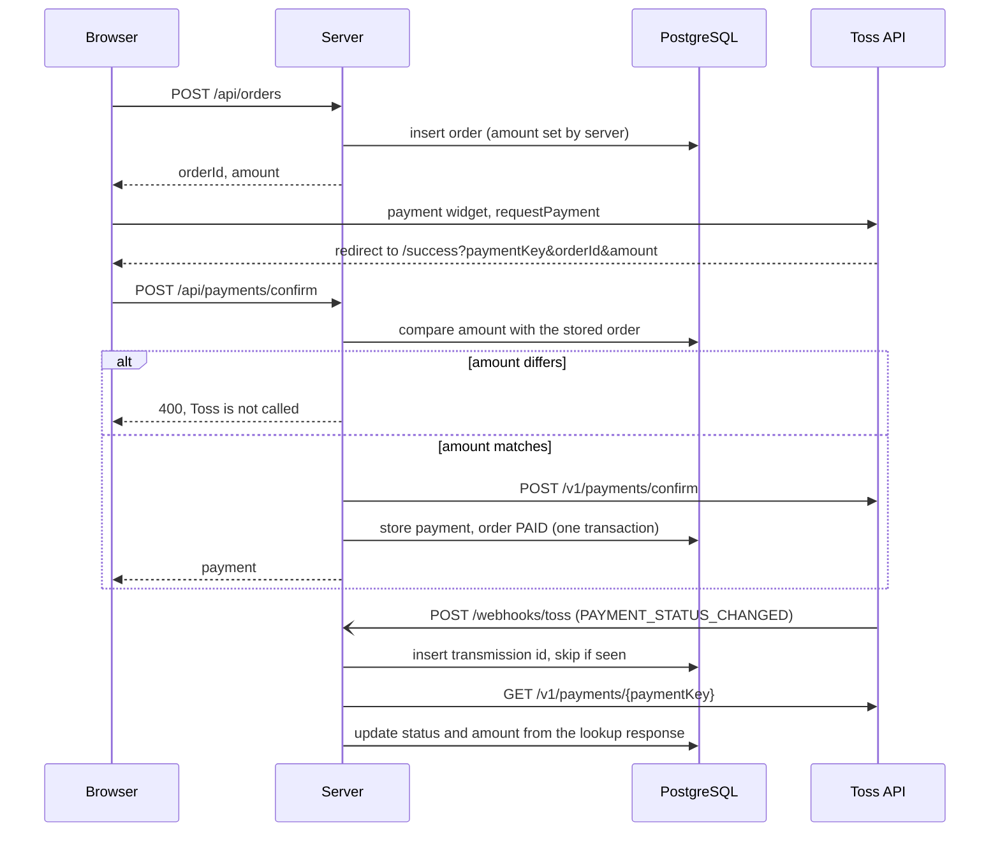

# payments-lab

A small Toss Payments (test environment) backend that does three things a payments service has to get right: confirm a payment only after checking the amount, take payment state from the lookup API instead of the webhook body, and reconcile Toss transactions against our own records.

I built it as a compact, readable sample of how I handle payment flows. It is about 350 lines of TypeScript, a one-page frontend, and 12 integration tests that run against a real PostgreSQL.

It uses only the public documentation test keys. No real money and no live keys are involved.

## Flow



Reconciliation is a script: `npm run reconcile` calls `GET /v1/transactions` for a period and diffs it against the `payments` table.

## Design decisions

1. **The webhook is a hint, the lookup response is the truth.** The webhook body is never written to the database. The handler only reads `paymentKey` from it, calls `GET /v1/payments/{paymentKey}`, and stores what that response says. A forged or stale webhook can at worst trigger one extra lookup. (The Toss docs describe signature checks only for payout and seller events, so lookup is how this event is verified.)
2. **Check the amount before calling confirm.** The amount on the success URL comes from the browser. The server compares it with the amount it stored when it created the order, and refuses before any call to Toss if they differ. The order amount is set by the server, never by the client.
3. **One order, one confirm.** Two confirm requests for the same order can arrive at once (double click, retry after a timeout). The order row is locked with `SELECT ... FOR UPDATE` for the whole confirm, so the second request waits, then sees `PAID` and returns the stored payment without calling Toss. The confirm call also sends `Idempotency-Key: confirm-{paymentKey}`, so if our side retries after a lost response, Toss returns the first result instead of approving again. The trade-off: the row lock is held during the Toss call.
4. **Reconcile with a boring diff.** Webhooks can be missed and confirm calls can fail halfway, so a periodic comparison is the safety net. It reports four kinds of problems: only at Toss, only in our database, different amount, different status. Exit code is 1 if anything is found, so it can run from cron.

Webhook deduplication uses the `tosspayments-webhook-transmission-id` header as a primary key. The event row and the status update share one transaction, so if the lookup fails the server answers 500, the row rolls back, and Toss's retry is processed normally.

## Run it

Requires Node 22+ and Docker.

```bash
cp .env.example .env        # docs test keys, already filled in
npm install
docker compose up -d --wait # PostgreSQL on port 5433, schema applied on first start
npm test                    # 14 tests against the real database
npm run lint && npm run typecheck
npm run dev                 # http://localhost:3000
```

On the page, pick bank transfer, press next, enter the test PIN `000000` twice (the widget tells you the PIN). You land on `/success` with the confirmed payment.

Replaying a webhook locally. Toss cannot reach localhost, so a real webhook is never delivered to this server. `npm run webhook:send` posts a `PAYMENT_STATUS_CHANGED` body in the documented format, with the documented transmission headers, to the local endpoint:

```bash
npm run webhook:send -- <paymentKey> <orderId> [transmissionId]
```

The server then does a real lookup call to Toss for that payment key. Sending the same transmission id twice returns `duplicate`.

Reconciliation:

```bash
npm run reconcile -- 2026-10-18T00:00:00 2026-10-18T23:59:59
```

Times are KST, in the format the Toss transactions API expects.

## What I did and did not do

Did:
- A real test payment in a browser (payment widget, bank transfer test flow) confirmed through the real Toss confirm API, then a real payment lookup through the replayed webhook.
- Integration tests for confirm (match, tampered amount, double confirm, two confirms at the same time, idempotency key, Toss rejection, unknown order), webhook (lookup is the source of truth, triple delivery, lookup failure then retry, unknown payment) and reconcile (all four mismatch kinds, clean case, period filter).

Did not:
- Live keys or real payments.
- Partial cancel, refunds, virtual accounts, billing keys.
- Settlement. Reconciliation compares approvals and statuses only, not payouts.
- Real webhook delivery. Only the local replay above.
- Recovery when Toss approves but our database write fails. The order stays `PENDING` and only reconciliation would catch it.

Known limits you should know about:
- The tests do not call Toss. They talk to a local HTTP server that serves JSON fixtures shaped like the documented responses, and the app uses its real HTTP client against it. The fixtures were written from the documentation, not recorded from live traffic. The real confirm and lookup calls were checked by hand in the browser run above.
- With the shared documentation keys, `GET /v1/transactions` returns an empty list, so a real reconcile run reports every local payment as only in our database. The reconcile logic is therefore verified against fixtures only. It needs a merchant's own test keys to run end to end.

## Layout

```
src/payments.ts   create order, confirm with amount check
src/webhook.ts    dedupe, lookup, update
src/reconcile.ts  diff Toss transactions against local payments
src/toss.ts       thin client for the three Toss endpoints used
src/app.ts        Hono routes
scripts/          reconcile and webhook replay CLIs
test/             integration tests, fixtures, fake Toss server
docs/SPEC.md      requirements and acceptance criteria
```
