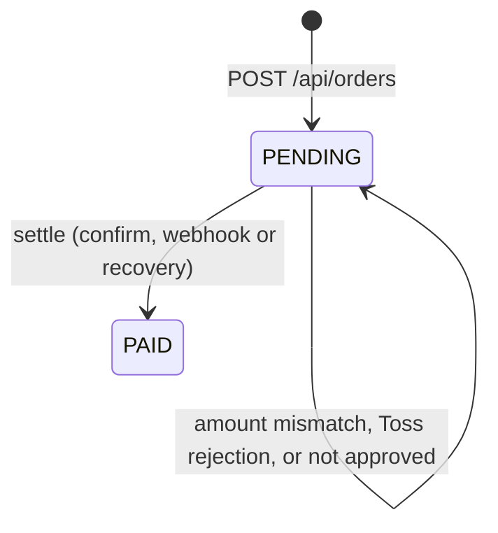

# States and the ways money and records drift apart

This page is the map of the repo. Every row below is a way the money at Toss and the records in our database can disagree, and the test that shows what happens. Rows marked "open" are planned, not done.

## Order states

One rule holds the diagram together: `settle` is the only code that sets `PAID`, and it always compares the Toss amount with the order amount first. Confirm, the webhook and the recovery command all call it ([ADR 0001](adr/0001-one-path-to-paid.md)).

Cancel states (`PARTIALLY_CANCELED`, `CANCELED`) come with milestone 2.

## Drift paths

| # | What goes wrong | Money / record | Caught by | Test |
|---|---|---|---|---|
| P1 | Toss approved, our DB write failed | gone / missing | `npm run recover` asks Toss by orderId and settles | `recovers an order when Toss approved but the DB write failed` |
| P2 | Confirm response lost (timeout, network) | gone / missing | same recovery; a browser retry also reuses the Idempotency-Key | `recovers an order when Toss approved but the DB write failed`, `sends an Idempotency-Key tied to the paymentKey so Toss also dedupes a retry` |
| P3 | Webhook arrives before our confirm commits | gone / not yet | webhook settles an approved payment for a known order; unknown payments do not consume the delivery id ([ADR 0002](adr/0002-webhook-before-confirm.md)) | `webhook that arrives before confirm is not lost`, `unknown_payment webhook does not consume the transmission id` |
| P4 | Same webhook delivered again | same | transmission id primary key | `applies the same delivery once when it is received 3 times` |
| P5 | Two webhooks race and an older lookup overwrites a newer status | same / wrong status | open (milestone 2) | |
| P6 | Webhook never arrives | same / wrong status | reconcile `STATUS_MISMATCH` | `reports one item for each kind of mismatch and nothing for matching payments` |
| P7 | Tampered amount on the success URL | none | amount check before confirm | `rejects a tampered amount without calling Toss` |
| P8 | Same order confirmed twice at once | double approval risk | order row lock + Idempotency-Key | `calls Toss confirm once when the same order is confirmed twice at the same time` |
| P9 | Cancelled at Toss, order still PAID | refunded / wrong order | open (milestone 2) | |
| P10 | Duplicate or concurrent cancel, cancel above balance | over-refund risk | open (milestone 2) | |
| P11 | In our DB, not at Toss | none / extra | reconcile `MISSING_AT_TOSS` | `reports one item for each kind of mismatch and nothing for matching payments` |
| P12 | Cancel transaction on another day than the approval | false alarm | open (milestone 3) | |
| P13 | Reconcile output only on the console | n/a | dropped from scope (the exit code is enough for cron) | |
| P14 | Internal error text in API responses, bad JSON gives 500 | n/a | open (milestone 4) | |

Recovery and the webhook refuse to settle when the Toss amount differs from the order amount: `recovery refuses to mark PAID when the Toss amount differs from the order amount`. Orders Toss never approved are left alone: `recovery is a no-op for orders that Toss never approved`.
