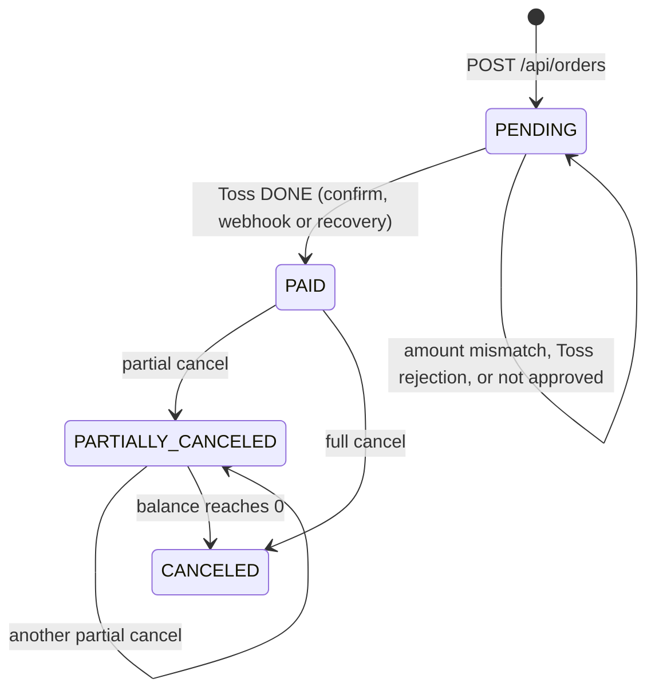

# States and the ways money and records drift apart

This page is the map of the repo. Every row below is a way the money at Toss and the records in our database can disagree, and the test that shows what happens. Rows marked "open" are planned, not done.

## Order states

One rule holds the diagram together: `applyPayment` is the only code that changes an order's status. It compares the Toss amount with the order amount, and status only moves forward while the balance only goes down ([ADR 0001](adr/0001-one-path-to-paid.md)). Cancels write their intent before calling Toss ([ADR 0003](adr/0003-cancel-intent-first.md)).

## Drift paths

| # | What goes wrong | Money / record | Caught by | Test |
|---|---|---|---|---|
| P1 | Toss approved, our DB write failed | gone / missing | `npm run recover` asks Toss by orderId and applies it | `recovers an order when Toss approved but the DB write failed` |
| P2 | Confirm response lost (timeout, network) | gone / missing | same recovery; a browser retry also reuses the Idempotency-Key | `recovers an order when Toss approved but the DB write failed`, `sends an Idempotency-Key tied to the paymentKey so Toss also dedupes a retry` |
| P3 | Webhook arrives before our confirm commits | gone / not yet | webhook applies an approved payment for a known order; unknown payments do not consume the delivery id ([ADR 0002](adr/0002-webhook-before-confirm.md)) | `webhook that arrives before confirm is not lost`, `unknown_payment webhook does not consume the transmission id` |
| P4 | Same webhook delivered again | same | transmission id primary key | `applies the same delivery once when it is received 3 times` |
| P5 | Two webhooks race and an older lookup overwrites a newer status | same / wrong status | forward-only status and balance in `applyPayment` | `older lookup result cannot overwrite a newer status when two webhooks race`, `a late approval webhook never moves a canceled order back to PAID` |
| P6 | Webhook never arrives | same / wrong status | reconcile `STATUS_MISMATCH` | `reports one item for each kind of mismatch and nothing for matching payments` |
| P7 | Tampered amount on the success URL | none | amount check before confirm | `rejects a tampered amount without calling Toss` |
| P8 | Same order confirmed twice at once | double approval risk | order row lock + Idempotency-Key | `calls Toss confirm once when the same order is confirmed twice at the same time` |
| P9 | Cancelled at Toss, order still PAID | refunded / wrong order | cancel applies the Toss result to the order | `partial cancel reduces the balance and sets PARTIALLY_CANCELED`, `cancel without an amount cancels the remaining balance` |
| P10 | Duplicate or concurrent cancel, cancel above balance, bad amount | over-refund risk | request key, one cancel in flight per order, balance check under the order lock | `same cancel request sent twice reaches Toss once`, `two concurrent cancels never exceed the paid amount`, `cancel above the balance is rejected with 0 Toss calls`, `cancelAmount of 0, -1, 1.5 or text is rejected with 0 Toss calls`, `reusing a cancel key with a different amount is rejected`, `a Toss rejection marks the cancel FAILED and frees the order for a new cancel` |
| P11 | In our DB, not at Toss | none / extra | reconcile `MISSING_AT_TOSS` | `reports one item for each kind of mismatch and nothing for matching payments` |
| P12 | Cancel transaction on another day than the approval | false alarm | open (milestone 3) | |
| P13 | Reconcile output only on the console | n/a | dropped from scope (the exit code is enough for cron) | |
| P14 | Internal error text in API responses, bad JSON gives 500 | n/a | open (milestone 4) | |
| P15 | Toss cancelled, our DB write failed | refunded / missing | cancel intent stays `REQUESTED`; recovery replays the same key and Toss returns the first result | `cancel that succeeded at Toss but failed in the DB is repaired by replaying the same key`, `recovery does not replay a cancel older than the Toss key window` |

Recovery and the webhook refuse to apply a Toss amount that differs from the order amount: `recovery refuses to mark PAID when the Toss amount differs from the order amount`. Orders Toss never approved are left alone: `recovery is a no-op for orders that Toss never approved`. A PENDING order cannot be cancelled: `cancel without an Idempotency-Key or of a PENDING order is rejected with 0 Toss calls`.

Checked against the real Toss test API with the docs key (2026-10-19, payment `tgen_20261018202314VjNB1`): the cancel flow cancelled 1,000 won (balance 8,000 → 7,000) and stored all four cancel transactions Toss listed; the same request key again made no Toss call; a cancel above the balance was refused before Toss; replaying the Toss key directly returned the first result without a new cancel.
